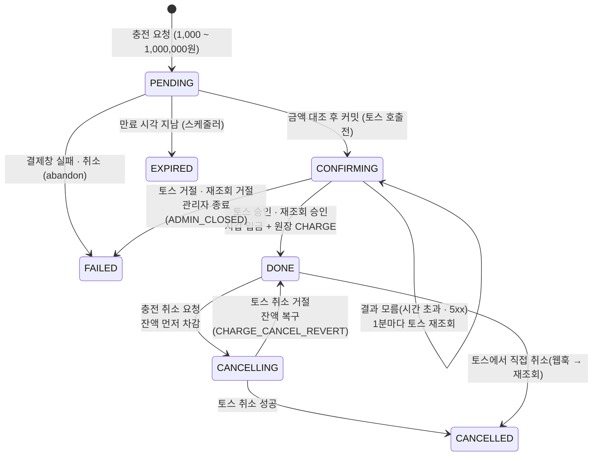

# Kidly BE

## 내 담당 (codes-gy)

> 이 저장소는 팀 프로젝트 [prgrms-be-adv-devcourse/beadv8_8_BBCC_BE](https://github.com/prgrms-be-adv-devcourse/beadv8_8_BBCC_BE)의 개인 fork입니다. 아래 코드 링크와 PR 번호는 모두 팀 저장소(upstream `develop`) 기준입니다.

**결제 도메인 담당**. 팀 저장소에 머지된 내 PR은 **169건**(2026-10-08 ~ 2026-11-20)이고, 영역별로는 다음과 같습니다(브랜치 이름의 영역 기준).

| 영역 | 머지된 PR | 추가한 줄 |
|---|---:|---:|
| 결제(payment) — 충전 · 결제 · 환불 · 정산 지급 · 아웃박스 | 46 | +20,523 |
| 공통 · 인프라(global · deploy · infra) — CI, Flyway, k3s 배포, Slack 알림 | 65 | +14,970 |
| 검색(search) — Elasticsearch 색인, 의미 검색, 장애 대응 | 27 | +10,139 |
| 챗봇(chatbot) — RAG 챗봇, 상품 · 주문 도구, 남용 방지 | 9 | +5,454 |
| 그 밖의 도메인(member · order · gateway 등) | 22 | +11,257 |

### 충전 상태 머신

[`Charge`](https://github.com/prgrms-be-adv-devcourse/beadv8_8_BBCC_BE/blob/develop/domains/payment/src/main/java/com/bbcc/kidly/boundedcontext/payment/domain/Charge.java) · [`ChargeConfirmService`](https://github.com/prgrms-be-adv-devcourse/beadv8_8_BBCC_BE/blob/develop/domains/payment/src/main/java/com/bbcc/kidly/boundedcontext/payment/app/ChargeConfirmService.java) · [`ChargeReconcileService`](https://github.com/prgrms-be-adv-devcourse/beadv8_8_BBCC_BE/blob/develop/domains/payment/src/main/java/com/bbcc/kidly/boundedcontext/payment/app/ChargeReconcileService.java) 코드 그대로의 전이입니다.

- **외부 호출은 트랜잭션 밖**: `CONFIRMING`을 먼저 커밋하고, 토스 승인은 트랜잭션 밖에서 부른 뒤 결과를 다시 짧은 트랜잭션으로 반영합니다. 외부 응답을 기다리는 동안 DB 커넥션과 락을 잡지 않습니다.
- **모르면 실패로 만들지 않는다**: 시간 초과 · 5xx는 `PgResult.Unknown`으로 받아 `CONFIRMING`으로 둡니다. 돈이 이미 빠져나갔을 수 있기 때문입니다. 5분 넘게 `CONFIRMING`인 충전은 스케줄러가 1분마다 토스에 다시 조회해 확정합니다.
- **비관적 락**: 충전은 `findWithLockById` · `findWithLockByTossOrderId`, 지갑은 [`JpaWalletRepository`](https://github.com/prgrms-be-adv-devcourse/beadv8_8_BBCC_BE/blob/develop/domains/payment/src/main/java/com/bbcc/kidly/boundedcontext/payment/out/JpaWalletRepository.java)의 `PESSIMISTIC_WRITE`로 읽어, 사용자 승인 · 스케줄러 · 웹훅이 겹쳐도 차례로 처리합니다. 상태가 기대와 다르면 `INVALID_CHARGE_STATUS`로 막습니다.
- **마지막 방어선은 DB 제약**: 원장 `wallet_ledger`의 `UNIQUE (type, ref_id)` 때문에 같은 충전이 두 번 입금될 수 없습니다.

### 실패 시나리오

| 상황 | 코드가 하는 일 | 관련 PR |
|---|---|---|
| 토스 승인 **시간 초과 · 5xx** | `Unknown`으로 받아 `CONFIRMING` 유지, 사용자에게는 "승인 중" 응답. 스케줄러가 재조회해 승인이면 입금, 거절이면 `FAILED`. 승인 금액이 다르거나 부분 취소된 건은 반영하지 않고 ERROR 로그 → 관리자가 [멈춘 충전 API](https://github.com/prgrms-be-adv-devcourse/beadv8_8_BBCC_BE/pull/1395)로 조회 · 종료(토스 결과를 모르거나 금액대로 승인됐으면 종료 거절) | #65, #166, #1395 |
| 같은 충전에 **승인 · 재조회 · 웹훅이 겹침** | 충전 · 지갑 비관적 락 + 상태 검사로 하나만 진행, 원장 유니크 키로 이중 입금 차단. 토스 승인 요청에는 주문번호를 `Idempotency-Key`로 보냄 | #129, #166 |
| 토스 **웹훅 중복 · 위조 본문** | 웹훅 본문을 믿지 않고 토스를 다시 조회해 전액 취소일 때만 반영. `DONE`이 아닌 충전은 넘어가 두 번째 웹훅은 아무것도 안 함. 조회 결과를 모르면 503을 돌려 토스가 다시 보내게 함 | #208 |
| **Kafka 발행 실패** | 이벤트는 업무와 같은 트랜잭션(`BEFORE_COMMIT`)에서 아웃박스에 저장. 릴레이가 보내다 실패하면 기록하고 멈춰 순서 유지, 시도 상한에 닿은 메시지는 다른 메시지가 나가는 경우(브로커는 정상)에만 **격리**하고 같은 키의 뒤 메시지도 보류 → 관리자가 원인을 고친 뒤 다시 보내기. 보낸 뒤 커밋 전에 멈추면 다시 보내고, 받는 쪽은 `eventId`로 거름 | #563, #1401 |
| **운영 중 감지** | Grafana 알림: 결제 이벤트 전송 지연 · 격리 · 전송 실패 반복, 결제 수신 메시지 DLT, 30분 넘게 승인 중 · 취소 중인 충전, 환불 재처리 지연 | #981, #1396 |

챗봇은 남용 방지를 맡았습니다: OpenAI에 주문 ID · 수량을 보내지 않기(#1397), 이전 대화를 확인되지 않은 기록으로만 넘기기(#1398), 질문 하나당 시간 상한(#1399), 하루 질문 수 상한(#1400).

### 대표 PR

- [#65 토스페이먼츠 결제 승인 · 취소 · 조회 클라이언트](https://github.com/prgrms-be-adv-devcourse/beadv8_8_BBCC_BE/pull/65) — 결과를 성공 · 거절 · 모름 세 가지로 나눔
- [#129 예치금 충전 요청 · 승인 API](https://github.com/prgrms-be-adv-devcourse/beadv8_8_BBCC_BE/pull/129) — 승인 3단계(커밋 → 외부 호출 → 반영)
- [#166 미확정 · 만료 충전 정리 스케줄러](https://github.com/prgrms-be-adv-devcourse/beadv8_8_BBCC_BE/pull/166) — `CONFIRMING` 재조회로 확정
- [#563 결제 이벤트를 아웃박스로 Kafka에 발행](https://github.com/prgrms-be-adv-devcourse/beadv8_8_BBCC_BE/pull/563)
- [#1401 결제 아웃박스에서 보낼 수 없는 메시지를 격리](https://github.com/prgrms-be-adv-devcourse/beadv8_8_BBCC_BE/pull/1401)

---

자녀 맞춤 키즈 패션 이커머스 백엔드. Spring Boot 4.1 · Java 25 · PostgreSQL 18 · Kafka 모듈러 모놀리스.

개발 규칙은 [`CLAUDE.md`](CLAUDE.md)를 따른다.

## 준비

- JDK 25, Docker Compose를 쓸 수 있는 Docker 환경 (Gradle은 Wrapper를 쓴다)

## 로컬 실행

1. `.env.example`을 루트에 `.env`로 복사한다. 로컬은 기본값이 있어 비워 둬도 된다(앱이 실행될 때 루트의 `.env`를 자동으로 읽는다)
2. `docker compose up -d` — PostgreSQL · Kafka · pgAdmin · Prometheus · Grafana
3. `./gradlew :apps:kidly-app:bootRun` — 앱(8080). 기본 프로필 local. 루트에서 실행한다(IDE는 공유 실행 구성 `KidlyApplication`)
4. `./gradlew :apps:gateway:bootRun` — Gateway(8083). 루트에서 실행한다(IDE는 `GatewayApplication`, 3 · 4를 한 번에 `Kidly 앱 + Gateway`)
5. `cd apps/member-service && ./gradlew bootRun` — 회원 서비스(8081). 루트 빌드와 따로, 자체 wrapper로 빌드한다([구조와 실행](apps/member-service/README.md)). 회원 · 인증 · 판매자 API(로그인 포함)는 앱에 없어 이 서비스를 띄워야 한다(Gateway가 8081로 넘긴다). 앱(3)이 한 번 뜬 뒤에 띄운다(빈 DB에서 먼저 뜨면 앱의 마이그레이션이 실패한다). IDE는 `MemberServiceApplication`
7. `./gradlew :apps:recommend-service:bootRun` — 추천 서비스(8086). 추천 API는 앱에 없어 이 서비스를 띄워야 한다(Gateway가 8086으로 넘긴다). 앱(3)이 한 번 뜬 뒤에 띄운다(빈 DB에서 먼저 뜨면 앱의 마이그레이션이 실패한다). IDE는 `RecommendServiceApplication`
8. `docker compose --profile search up -d` 뒤 `./gradlew :apps:search-service:bootRun` — 검색 서비스(8082). 상품 목록(`GET /api/v1/products`)은 앱에 없어 이 서비스를 띄워야 한다(Gateway가 8082로 넘긴다). 색인은 처음 뜬 뒤 판매자 · 상품을 바꾸거나 관리자 다시 보내기로 채운다
9. `./gradlew :apps:payment-service:bootRun` — 결제 서비스(8087). 결제 API는 앱에 없어 이 서비스를 띄워야 한다(Gateway가 8087로 넘긴다). 앱(3)이 한 번 뜬 뒤에 띄운다(빈 DB에서 먼저 뜨면 앱의 마이그레이션이 실패한다). IDE는 `PaymentServiceApplication`
10. `./gradlew :apps:settlement-service:bootRun` — 정산 서비스(8088). 정산 API는 앱에 없어 이 서비스를 띄워야 한다(Gateway가 8088로 넘긴다). 앱(3)이 한 번 뜬 뒤에 띄운다(빈 DB에서 먼저 뜨면 앱의 마이그레이션이 실패한다). IDE는 `SettlementServiceApplication`
11. `./gradlew :apps:product-service:bootRun` — 상품 서비스(8089). 상품 API는 앱에 없어 이 서비스를 띄워야 한다(Gateway가 8089로 넘긴다). 앱(3)이 한 번 뜬 뒤에 띄운다(빈 DB에서 먼저 뜨면 앱의 마이그레이션이 실패한다). IDE는 `ProductServiceApplication`
12. `./gradlew :apps:order-service:bootRun` — 주문 서비스(8091). 주문 · 장바구니 · 배송 · 조르기 API는 앱에 없어 이 서비스를 띄워야 한다(Gateway가 8091로 넘긴다). 앱(3)이 한 번 뜬 뒤에 띄운다(빈 DB에서 먼저 뜨면 앱의 마이그레이션이 실패한다). IDE는 `OrderServiceApplication`
13. `./gradlew :apps:community-service:bootRun` — 커뮤니티 서비스(8092). 리뷰 · 찜 API는 앱에 없어 이 서비스를 띄워야 한다(Gateway가 8092로 넘긴다). IDE는 `CommunityServiceApplication`
14. `./gradlew :apps:notification-service:bootRun` — 알림 서비스(8090). 가입 환영 메일은 앱에 없어 메일을 보려면 이 서비스를 띄워야 한다(HTTP API는 없다). 앱(3)이 한 번 뜬 뒤에 띄운다(빈 DB에서 먼저 뜨면 앱의 마이그레이션이 실패한다). IDE는 `NotificationServiceApplication`

- pgAdmin: http://localhost:5050 — 로그인 `admin@kidly.dev` / `kidly`, 등록된 PostgreSQL 서버 접속 비밀번호 `kidly` (로컬 개발용)
- 프론트와 Swagger(http://localhost:8083/swagger-ui.html)는 Gateway 주소(8083)로 붙는다. Swagger 위쪽에서 앱 문서(`kidly`)와 `회원` · `추천` · `결제` · `상품` 문서를 고른다. 자녀 API는 회원 문서에 포함된다. 앱(8080)에 직접 붙으면 Gateway가 붙이는 헤더가 없어 로그인이 필요한 API는 401이고, 앱에는 CORS 설정이 없어 브라우저(프론트 5173)에서는 공개 API도 막힌다
- Gateway는 Kafka(`kidly.auth.events`)로 토큰 무효화를 받는다. 회원 서비스보다 먼저 떠도 기동은 되지만, 회원 서비스가 한 번 떠서 토픽이 만들어진 뒤에 무효화 목록이 채워진다
- 회원 · 판매자 토픽(`kidly.member.events` · `kidly.seller.events`)은 회원 서비스가 처음 뜰 때 만든다. 새 Kafka에서는 자녀 토픽과 같은 이유로 그 전에 떠 있던 앱의 리스너(주문)와 결제 · 상품 · 알림 서비스의 리스너가 그 사이에 나간 메시지(회원 서비스가 뜨며 넣는 초기 회원 · 판매자 데이터 등)를 건너뛴다. 처음 한 번은 회원 서비스를 띄운 뒤 앱과 결제 · 상품 · 알림 서비스를 다시 시작한다
- 자녀 토픽(`kidly.childprofile.events`)은 회원 서비스가 처음 뜰 때 만든다. 새 Kafka(빈 `kafka-data` 볼륨)에서는 그 전에 떠 있던 앱의 주문 리스너와 추천 서비스의 리스너가 몇 초 뒤 메타데이터를 갱신하고서야 토픽을 받고, 책갈피가 없어 그때의 끝(`auto-offset-reset: latest`)부터 읽는다. 그 사이에 나간 자녀 메시지(서비스가 뜨며 넣는 초기 자녀 데이터 등)는 건너뛰고 다시 오지 않는다. 처음 한 번은 회원 서비스를 띄운 뒤 앱과 추천 서비스를 다시 시작한다
- 검색 토픽(`kidly.search.events`)은 검색 서비스가 처음 뜰 때 만든다. 검색 서비스(8)를 띄우기 전에는 토픽이 없으므로, 추천 서비스는 기동은 되지만 검색 리스너가 토픽을 찾는 `UNKNOWN_TOPIC_OR_PARTITION` WARN을 1초에 한두 줄씩 남긴다. 검색 서비스를 한 번 띄워 토픽이 생기면 사라진다
- 상품 토픽(`kidly.product.events`)은 상품 서비스가 처음 뜰 때 만든다. 새 Kafka에서는 그 전에 떠 있던 앱의 리스너(주문 · 커뮤니티)가 그 사이에 나간 상품 메시지(상품 서비스가 뜨며 넣는 초기 상품 데이터 등)를 건너뛴다. 처음 한 번은 상품 서비스를 띄운 뒤 앱을 다시 시작하거나, 관리자 `POST /api/v1/admin/products/changed-events`로 판매 중인 상품의 `product.changed`를 다시 보낸다
- 추천 서비스는 앱이 한 번 뜬 뒤에 띄우므로, 새 Kafka에서는 회원 · 상품 서비스가 처음 뜨며 넣은 초기 판매자 · 상품 데이터의 메시지가 추천 서비스의 구독 그룹(`kidly.recommend`) 책갈피가 생기기 전에 나가 추천 복사본에 들어오지 않는다. 그 뒤 판매자 · 상품을 바꾸거나 새로 만들면 그때부터 들어온다(읽기 시작 위치는 팀 규칙대로 `latest`다)

## 빌드 · 테스트

| 할 일 | 명령 | Docker |
|---|---|---|
| 전체(Checkstyle · ArchUnit · 모든 테스트) | `./gradlew build` | 필요 |
| 경계 규칙만 | `./gradlew archTest` | 불필요 |
| 단위 테스트(`XxxTest`) | `./gradlew test` | 불필요 |
| 통합 테스트(`XxxIntegrationTest`, Kafka 통합 테스트 포함) | `./gradlew integrationTest` | 필요 |
| 기능 테스트(`XxxApiTest`) | `./gradlew functionalTest` | 필요 |

## 모듈

| 모듈 | 내용 |
|---|---|
| `apps/kidly-app` | 실행 앱. 앱 설정, 공통 테스트 기반(`support`, `TestcontainersConfiguration`) |
| `apps/gateway` | API Gateway(WebFlux). 토큰 검증 · 무효화 확인 · 역할 검사 · CORS · 라우팅 |
| `apps/member-service` | 회원 서비스. 회원 · 인증 · 판매자 도메인은 이 서비스에만 있다. 빈 DB에서는 앱이 먼저 회원 테이블을 만들고, 서비스는 그 버전에서 baseline을 잡는다 |
| `apps/recommend-service` | 추천 서비스(#704). 추천 도메인은 이 서비스에만 있다 |
| `apps/payment-service` | 결제 서비스(#525). 결제 도메인은 이 서비스에만 있다. 결제 마이그레이션은 서비스 `baseline-version`(`202611021930`, 고정)보다 뒤 버전으로 더한다 |
| `apps/settlement-service` | 정산 서비스(#729). 정산 도메인은 이 서비스에만 있다. 구매확정 · 지급 결과는 Kafka로만 받으므로 수신 스위치(`SETTLEMENT_KAFKA_CONSUMER_ENABLED`)를 끄면 이벤트를 받지 못한다 |
| `apps/product-service` | 상품 서비스(#791). 상품 도메인은 이 서비스에만 있다. 상품 마이그레이션(`domains/product`의 `db/migration/product`)은 이 서비스만 적용한다(앱은 옛 상품 이력 행을 검증 전에 지운다). 서비스 baseline은 처음 기동 때 한 번만 잡혀 올려도 소용없다 |
| `apps/order-service` | 주문 서비스(주문 · 장바구니 · 배송 · 조르기, #826). 주문 도메인은 이 서비스에만 있다. 주문 마이그레이션은 이 서비스만 적용한다(앱은 옛 주문 모듈 이력 행을 검증 전에 지운다). 빈 DB에서 앱이 init으로 만든 주문 표 위에 서비스가 baseline(`202611031100`, 고정)을 잡고, 건너뛴 주문 모듈 표는 보강 마이그레이션이 만든다 |
| `apps/community-service` | 커뮤니티 서비스(리뷰 · 찜, #827). 커뮤니티 도메인은 이 서비스에만 있다. 마이그레이션은 도메인 모듈에만 있고 이 서비스만 적용한다. 이미 테이블이 있는 DB는 baseline(`202611031200`, 고정)으로 건너뛴다 |
| `apps/notification-service` | 알림 서비스(#833). 알림 도메인은 이 서비스에만 있다. 회원 가입 이벤트를 받아(구독 그룹 `kidly.notification`) 환영 메일을 보낸다. HTTP API가 없어 Gateway 라우트가 없다. 알림 테이블은 빈 DB에서 앱이 먼저 만들고, 서비스는 `202610190901`(고정)에서 baseline을 잡는다. 새 알림 마이그레이션은 `domains/notification`의 `db/migration/notification`에 둔다 |
| `common` | 공통 코드(`global`): 이벤트 발행, 메일, 엔티티 기반 클래스, 오류 · 응답 형식 |
| `shared` | 도메인 사이 계약: 이벤트(`DomainEvent`), 도메인별 `event` · `dto` · `domain` · `out` |
| `domains/*` | 도메인 모듈. 폴더 이름이 도메인 이름이다 |
| `apps/member-service/{auth,member,seller,support}` | 회원 서비스 빌드의 Gradle 모듈. 회원 서비스는 자체 settings를 가진 별도 빌드다. [구조와 실행](apps/member-service/README.md) |
| `architecture` | 도메인 모듈 안의 계층 규칙(ArchUnit `LayerRules`) |

## 인증

토큰 검증 · 무효화 확인 · 역할 검사 · CORS는 Gateway만 한다. 서비스는 Spring Security 없이 Gateway가 붙인 헤더로 로그인 회원을 안다.

- Gateway는 밖에서 온 `X-Member-*` · `X-Admin-*` · `X-Child-*`를 지우고, 검증을 통과한 회원 토큰이면 `X-Member-Id` · `X-Member-Roles` · `X-Member-Nickname`(UTF-8 퍼센트 인코딩)을, 관리자 토큰이면 `X-Admin-Id`만, 자녀 토큰이면 `X-Child-Account-Id` · `X-Child-Guardian-Id`만 붙인다. 계약은 `shared`의 `com.bbcc.kidly.shared.auth`(토큰 주체 `PrincipalId` · 주체 헤더 `PrincipalHeaders` · 회원 헤더 `MemberHeaders` · 역할 `Role` · 토큰 클레임 이름 `AccessTokenClaims`)다
- 회원 로그인이 필요한 API는 `@LoginMember AuthMember`(회원 ID · 닉네임)를, 관리자 로그인이 필요한 API는 `@LoginAdmin AuthAdmin`(관리자 ID)을, 자녀 전용 API는 `@LoginChild AuthChild`(자녀 계정 ID · 보호자 회원 ID)를 받는다. 자녀 토큰에는 `X-Member-Id`가 없어 회원 API는 401이다. 헤더가 없거나 잘못되면 401이다. 그 밖의 API는 공개다
- `/api/v1/admin/**`는 관리자 주체, `/api/v1/seller/**`는 SELLER 역할의 회원 주체만, `/api/v1/child/**`는 자녀 주체만 Gateway가 통과시킨다(토큰이 없으면 401, 주체 또는 역할이 다르면 403). 서비스는 역할 경로를 검사하지 않는다
- Gateway는 보안 응답 헤더를 붙이고, 정규화되지 않은 경로 · 위험한 요청은 400으로 막는다

서비스는 Gateway 뒤에서만 열린다는 전제다(dev 8083 · prod 8084 · 로컬 8083). Gateway를 거치지 않고 서비스에 닿을 수 있으면 `X-Member-*` 헤더를 위조할 수 있다. 자세한 Gateway 동작은 [`apps/gateway/CLAUDE.md`](apps/gateway/CLAUDE.md)

기본 요청 로그는 정규화 경로·상태·소요시간·traceId만 남기며, 요청·응답 본문과 헤더·IP·회원 식별값은 남기지 않는다. [요청 로그 정책](deploy/monitoring/docs/request-log-policy.md)을 따른다.
